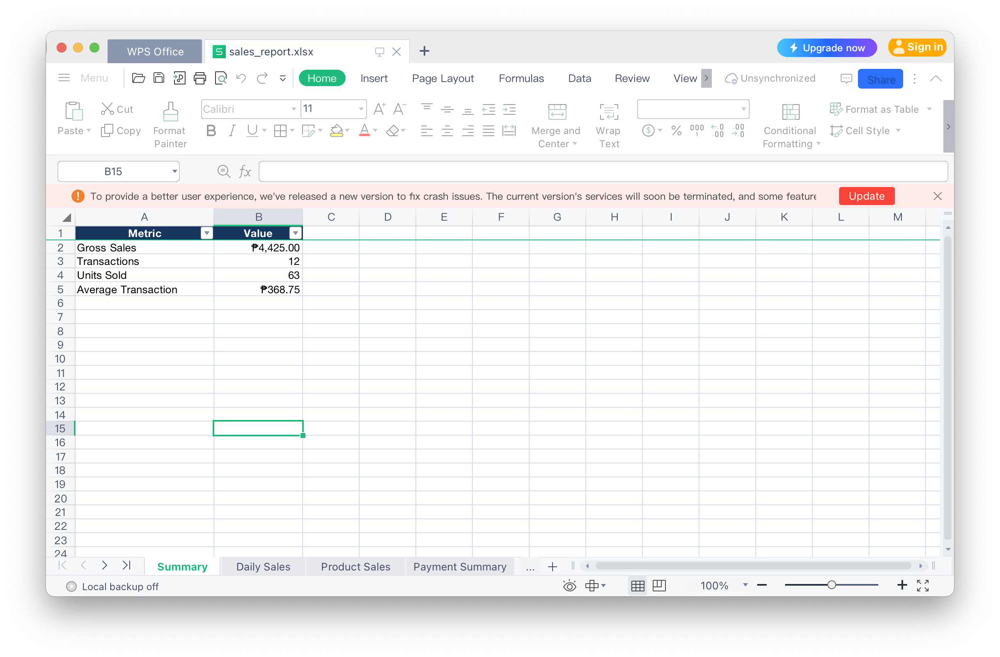
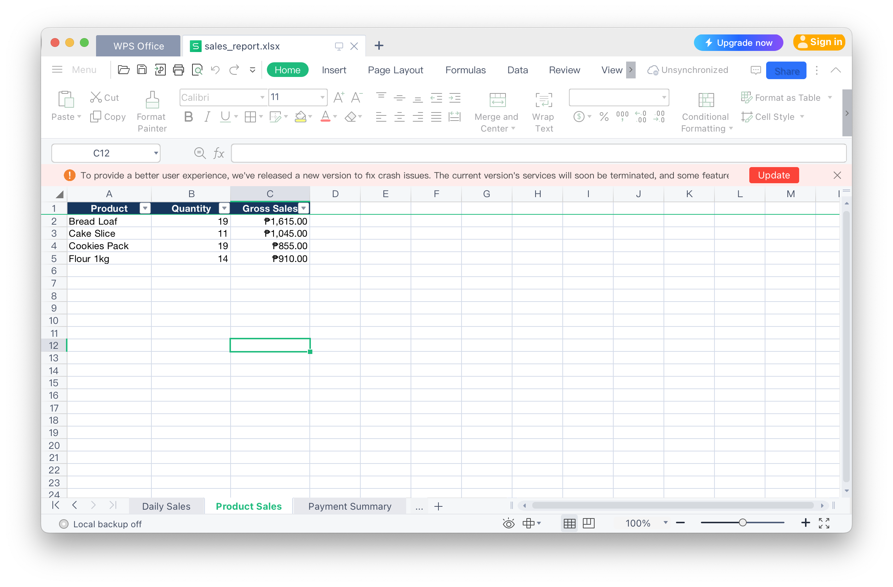
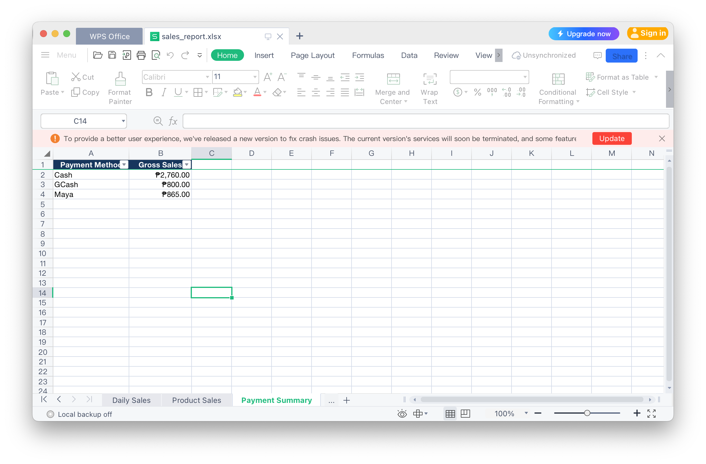

# Python Sales Report Automation

A Python-based sales reporting tool that converts CSV transaction records into a formatted Excel workbook.

## Overview

This project demonstrates how Python can automate repetitive retail sales reporting tasks, reducing manual spreadsheet preparation and improving reporting consistency.

## Features

- Import and validate CSV sales transactions
- Calculate daily gross sales
- Summarize product quantities and revenue
- Group sales by payment method
- Generate a formatted Excel workbook
- Identify duplicate transaction IDs and invalid input data

## Screenshots

### Sales Summary


### Daily Sales


### Product Sales


### Payment Summary


## Technology Stack

- Python 3
- OpenPyXL
- CSV
- Decimal for monetary calculations

## Installation

Clone the repository and navigate to the project:

```bash
git clone https://github.com/YOUR_USERNAME/sales-report-automation.git
cd sales-report-automation
```

Create and activate a virtual environment:

```bash
python3 -m venv .venv
source .venv/bin/activate
pip install -r requirements.txt
```

## Usage

```bash
python generate_report.py
```

The program reads `sales_data.csv` and generates `sales_report.xlsx` with four worksheets:

1. Summary
2. Daily Sales
3. Product Sales
4. Payment Summary

## Example Output

The fictional sample dataset contains 12 transactions, 63 units sold, and ₱4,425.00 in gross sales.

## Future Improvements

- Monthly and date-range reporting
- Multiple CSV file imports
- Excel charts and dashboards
- Automated scheduled reporting
- Additional report validation

## About the Developer

I specialize in Python automation, Excel reporting, ERP systems, inventory management, and business software development.

My background includes over 10 years of experience supporting accounting, inventory, procurement, and business operations using SAP Business One.

*All sample transactions in this repository are fictional and are provided for demonstration purposes.*